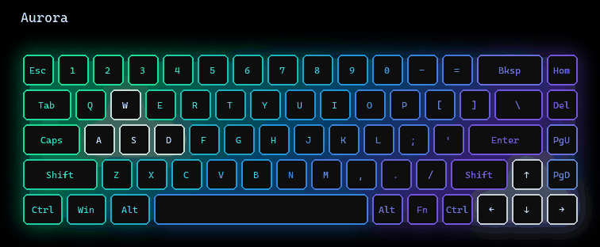
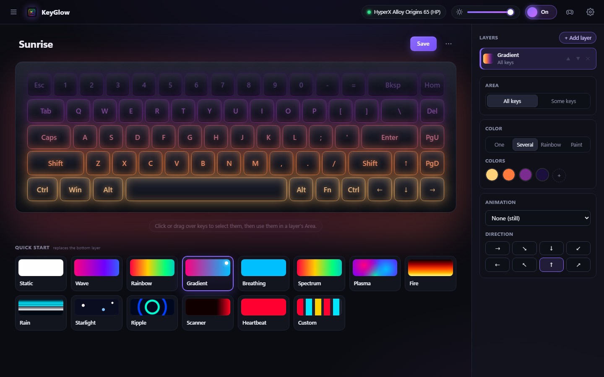

# KeyGlow

**Free, open-source RGB lighting for your keyboard, with profiles that work on any keyboard.**
A profile made for another keyboard (a full-size, a 60%, another brand) adapts itself to
yours, and the other way round. Windows, powered by [OpenRGB](https://openrgb.org).

<p align="center">
  <a href="https://github.com/HiddenOnLies/KeyGlow/releases"><b>⬇ Download KeyGlow.exe</b></a>
  ·
  <a href="#quick-start">Quick start</a>
  ·
  <a href="docs/compatibility.md">Compatibility</a>
</p>



> **Early preview.** KeyGlow works day to day on a **HyperX Alloy Origins 65** on Windows,
> but it hasn't been tested on other keyboards yet and there is still plenty to do.
> See [Status and roadmap](#status-and-roadmap). Feedback and issues are welcome.

## Why another RGB app?

| Problem | How KeyGlow handles it |
|---|---|
| Profiles are tied to one keyboard model | Colors are stored by **key name** and **physical position**, not by LED index |
| Every program names keys differently | Key names from OpenRGB, browsers, QMK and Linux are translated both ways |
| A 104-key profile gets "cut off" on a 65% | Two modes: **by name** (W stays W) or **portable** (the whole design is rescaled to your keyboard, like an image) |
| Profiles are locked inside each app | Import and export **OpenRGB profiles**, key color maps and CSV ([details](docs/compatibility.md#other-programs)) |
| Sharing profiles is risky | A profile is **plain JSON, never code**, so it is safe to download from any URL |
| One app per brand | Hardware is driven through **[OpenRGB](https://openrgb.org)**, and the keyboard layout is **detected automatically** |

## Quick start

1. **Install [OpenRGB](https://openrgb.org/releases.html)** (free). KeyGlow uses it to talk to
   the keyboard; you don't need to configure it.
2. **Download [`KeyGlow.exe`](https://github.com/HiddenOnLies/KeyGlow/releases)** and
   double-click it. No installer: it's a single file you can keep anywhere.
   KeyGlow opens OpenRGB for you in the background with its SDK server on.
3. **Pick an effect.** If the keyboard doesn't light up, KeyGlow shows what's missing (usually
   another RGB app such as NGENUITY, iCUE or Synapse still running: close it).

To keep your lighting after a restart, turn on *Settings → Start KeyGlow with Windows*.

> **Windows SmartScreen** may say it "protected your PC" the first time, because the
> executable isn't code-signed yet. Click *More info → Run anyway*. You can check the file
> against the SHA-256 published in each release, or [run from source](#running-from-source).



## The app

Double-click `KeyGlow.exe`. The interface opens in its own window and an icon appears in the
system tray with *Open KeyGlow*, *Lights off* and *Quit*. The lights keep running when you
close the window.

- **Quick start effects**: Static, Wave, Rainbow, Gradient, Breathing, Spectrum, Plasma, Fire,
  Rain, Starlight, Ripple, Scanner, Heartbeat, Swirl, Comet, Bounce, Glitch and Custom (paint keys
  with the mouse).
- **Layer editor**: each layer is an *Area* (all or some keys) + a *Color* (one, several,
  rainbow or hand-painted) + an *Animation*, with opacity and blend modes.
- **On key press**: light up the key you press, a ripple or a burst from it, its row, or its row
  and column. It uses a Windows
  keyboard hook only while an active profile needs it, and only keeps which key was pressed and
  when, in memory, for a few seconds.
- **Profiles**, always on the left: built-in presets, your own (`Documents\KeyGlow\Perfiles`)
  and the [community gallery](https://github.com/HiddenOnLies/KeyGlow-profiles), which the app
  keeps up to date by itself (add yours!). Hover a profile to preview it on the keyboard; click
  to use it. *Edit* opens the layer editor.
- **Shortcut lights**: hold Ctrl, Alt or Win and the keys of their shortcuts light up, for
  Windows and apps like VS Code, browsers or Photoshop (off in games).
- **Game profiles** (controller icon): one profile per game while it is in focus, plus optional
  recommended profiles for ~40 popular games.
- **Import / export** (⋯): KeyGlow and OpenRGB profiles, key color maps (OpenRGB, web, QMK names)
  and CSV. Drag a file onto the window to import it.
- **Save to keyboard memory** on keyboards that support it, so no software has to stay open
  ([which ones](docs/compatibility.md#saving-to-the-keyboards-memory)).
- **Any keyboard**: the layout comes from OpenRGB automatically; 9 standard layouts (ANSI/ISO,
  60% to full size) are built in. See [compatibility](docs/compatibility.md).

## Command line

```bash
keyglow layouts                                      # built-in keyboard layouts
keyglow preview examples/aurora.json --seconds 10    # animation in the terminal
keyglow import my_profile.orp -o mine.json           # OpenRGB, key maps, CSV, URLs…
keyglow export examples/aurora.json --format openrgb # for OpenRGB (or keys-web, keys-qmk, csv)
keyglow apply examples/aurora.json                   # play it on the real keyboard
keyglow capture -o what_i_had.json                   # save the colors the keyboard shows now
```

Run `keyglow --help` for everything else.

## Documentation

- [Compatibility](docs/compatibility.md): keyboards, layouts and other programs' formats
- [KeyGlow workshop](https://github.com/HiddenOnLies/KeyGlow-layouts): community keyboard layouts the app downloads (add yours!)
- [KeyGlow community gallery](https://github.com/HiddenOnLies/KeyGlow-profiles): community lighting profiles the app downloads (add yours!)
- [Profile format](docs/profile-format.md): layers, effects, key groups, galleries
- [Profile sources](docs/profile-sources.md): where the included profiles come from, and candidates
- [Contributing](CONTRIBUTING.md): development setup and repository layout
- [Changelog](CHANGELOG.md)

## Running from source

Python 3.10+.

```bash
python -m venv .venv
.venv\Scripts\activate
pip install -e ".[app,hid,dev]"
keyglow-app                 # the desktop app
pytest                      # tests
powershell -ExecutionPolicy Bypass -File tools\build_exe.ps1   # builds dist\KeyGlow.exe
```

## Status and roadmap

- **Only tested on one keyboard** (HyperX Alloy Origins 65, Windows 11). The automatic layout
  should handle other OpenRGB keyboards, but reports from real hardware are the most useful
  contribution right now.
- **Windows only** for the desktop app (tray icon, keyboard hook, game detection). The library
  and CLI are plain Python.
- **Some code comments are still in Spanish**; they will be translated.
- Next: more profile sources ([candidates](docs/profile-sources.md#good-candidates)),
  audio-reactive effects, mice and other devices.

## License

[MIT](LICENSE). The bundled fonts (IBM Plex Sans, IBM Plex Mono, Space Grotesk) are under the
SIL Open Font License; see `keyglow/app/static/fonts/`. `keyglow/community/gallery.json` is a copy
of the [community gallery](https://github.com/HiddenOnLies/KeyGlow-profiles) (MIT, with its own
credits for the theme palettes).
